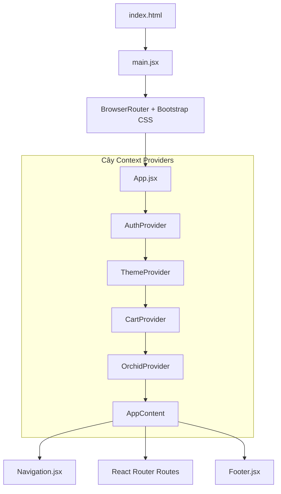
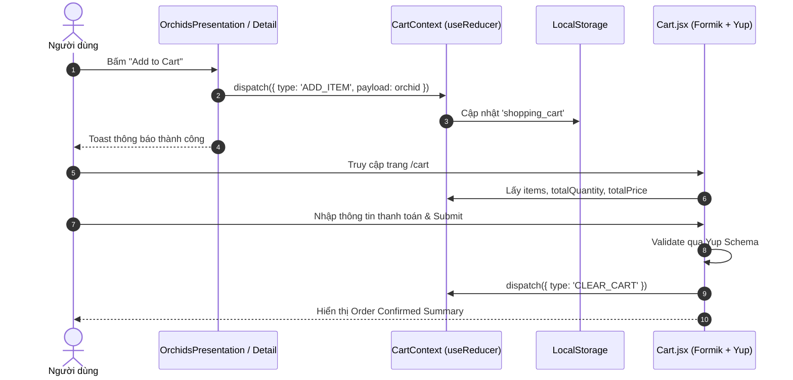
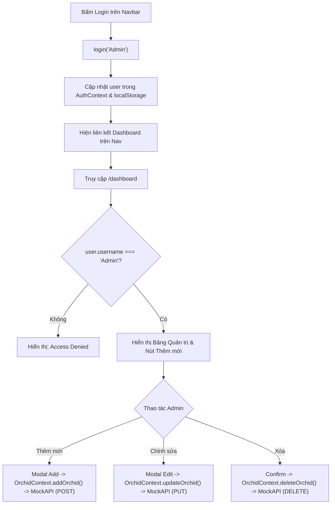

# Kiến Trúc & Luồng Hoạt Động Hệ Thống (Project Architecture & Flow)

Dự án: **Orchid Flower Collection App (`orchid-app`)**  
Công nghệ chính: **React 19 + Vite, React Router v7, React Bootstrap, Formik + Yup, Context API + useReducer, React Toastify**.

---

## 1. Tổng Quan Kiến Trúc (Architecture Overview)

Ứng dụng được thiết kế theo mô hình **Single Page Application (SPA)** với các nguyên lý thiết kế:
- **Hierarchical Context Providers:** Quản lý state toàn cục phân tầng thông qua các Provider lồng nhau.
- **Container - Presentational Pattern:** Tách biệt logic xử lý / lọc dữ liệu khỏi phần render giao diện hiển thị.
- **Client-side Routing:** Điều hướng trang không cần tải lại trình duyệt bằng React Router v7.
- **Persistent State:** Tự động đồng bộ giỏ hàng và phiên làm việc xuống `localStorage`.

---

## 2. Cấu Trúc Thư Mục (Directory Structure)

```text
orchid-app/
├── public/
│   └── assets/              # Tài nguyên ảnh hoa lan (img1.jpg -> img10.jpg)
├── src/
│   ├── assets/              # Assets bổ trợ giao diện
│   ├── App.css              # Style tùy chỉnh (popup, overlay)
│   ├── index.css            # CSS gốc chuẩn hóa layout
│   ├── ListOfOrchids.js     # Dữ liệu tĩnh dự phòng cho hoa lan
│   ├── main.jsx             # Entrypoint khởi tạo React DOM, BrowserRouter, Bootstrap CSS
│   ├── App.jsx              # Cây bọc Context Providers & Cấu hình Routes
│   ├── Navigation.jsx       # Thanh điều hướng (Header, Login Admin, Theme Toggle)
│   ├── Footer.jsx           # Chân trang với thông tin tác giả & bản quyền
│   ├── AuthProvider.jsx     # Quản lý trạng thái xác thực người dùng
│   ├── ThemeProvider.jsx    # Quản lý chế độ Dark / Light mode
│   ├── CartContext.jsx      # Quản lý state giỏ hàng (useReducer + LocalStorage)
│   ├── OrchidContext.jsx    # Quản lý dữ liệu hoa lan & giao tiếp MockAPI (CRUD)
│   ├── Orchids.jsx          # Container Component trang chủ (Home)
│   ├── OrchidsPresentation.jsx # Presentational Component hiển thị Grid hoa lan
│   ├── Naturals.jsx         # Container lọc hoa lan tự nhiên (isNatural)
│   ├── Detail.jsx           # Trang chi tiết hoa lan dựa trên param id
│   ├── Cart.jsx             # Trang giỏ hàng & Form đặt hàng (Formik + Yup)
│   ├── Contact.jsx          # Trang liên hệ & Form xác thực (Formik + Yup)
│   └── Dashboard.jsx        # Bảng điều khiển Admin quản lý CRUD hoa lan
├── index.html               # Trang HTML gốc
├── vite.config.js           # Cấu hình Vite bundler & React Compiler
└── package.json             # Danh sách dependencies & scripts
```

---

## 3. Luồng Khởi Chạy & Cây Phân Tầng Context (Provider Tree)



### Vai trò từng Provider:
1. **`AuthProvider`**:
   - Cung cấp `user`, `login(username)`, `logout()`.
   - Khởi tạo state bằng hàm lười (lazy initializer) đọc từ `localStorage.getItem('user')`.
2. **`ThemeProvider`**:
   - Cung cấp theme palette (`backgroundColor`, `color`, `cardBg`, `cardText`), trạng thái `dark` (boolean) và hàm `toggle()`.
   - Lưu trạng thái theme vào `localStorage.getItem('dark')`.
3. **`CartProvider`**:
   - Khởi tạo giỏ hàng từ `localStorage.getItem('shopping_cart')`.
   - Sử dụng `useReducer` xử lý các action: `ADD_ITEM`, `REMOVE_ITEM`, `UPDATE_QUANTITY`, `CLEAR_CART`.
   - Cung cấp biến tính toán sẵn `totalQuantity` và `totalPrice`.
4. **`OrchidProvider`**:
   - Gọi MockAPI khi ứng dụng mount để nạp danh sách `orchids`.
   - Cung cấp các hàm bất đồng bộ cho toàn bộ ứng dụng: `addOrchid`, `updateOrchid`, `deleteOrchid`.

---

## 4. Chi Tiết Các Luồng Nghiệp Vụ (Business Logic Flows)

### 4.1. Luồng Duyệt & Hiển Thị Hoa Lan (Orchids Browsing)
```mermaid
flowchart LR
    API[("MockAPI")] -->|fetchOrchids| OP["OrchidContext"]
    OP -->|orchids| Home["Orchids (/)"]
    OP -->|orchids.filter(isNatural)| Nat["Naturals (/naturals)"]
    Home --> Pres["OrchidsPresentation"]
    Nat --> Pres
    Pres -->|Detail Button| Detail["Detail (/detail/:id)"]
    Pres -->|Add to Cart| Cart["CartContext (dispatch)"]
```
- **Tách biệt hiển thị:** `Orchids.jsx` lấy toàn bộ danh sách, `Naturals.jsx` lọc theo điều kiện `orchid.isNatural === true`. Cả hai đều tái sử dụng `OrchidsPresentation.jsx` để kết xuất giao diện thẻ (Card).
- **Trang Chi Tiết:** `Detail.jsx` nhận `:id` từ URL qua hook `useParams()`, tìm kiếm trong danh sách hoa lan và hiển thị toàn bộ thông tin chi tiết, màu sắc, nguồn gốc, đánh giá sao.

---

### 4.2. Luồng Giỏ Hàng & Đặt Hàng (Cart & Checkout Flow)

- **Xác thực biểu mẫu:** Form thanh toán sử dụng **Formik** và schema **Yup** kiểm tra:
  - Họ tên tối thiểu 3 ký tự.
  - Định dạng Email hợp lệ.
  - Số điện thoại đúng chuẩn 10 chữ số (`/^[0-9]{10}$/`).
  - Địa chỉ và cam kết điều khoản bắt buộc.
- **Xử lý đơn:** Khi đặt hàng thành công, hiển thị bảng tóm tắt đơn hàng và làm sạch giỏ hàng.

---

### 4.3. Luồng Xác Thực & Quản Trị Hệ Thống (Auth & Admin Dashboard)

- **Component Route Guard:** `Dashboard.jsx` kiểm tra quyền trực tiếp tại component, ngăn chặn truy cập trái phép.
- **Đồng bộ thời gian thực:** Mỗi khi thao tác CRUD thành công, `OrchidContext` tự động gọi lại `fetchOrchids()` để cập nhật dữ liệu mới nhất trên giao diện.

---

## 5. Lưu Ý Kỹ Thuật Khi Phát Triển

1. **Chuẩn JSX trong Vite:** Mọi file chứa mã JSX bắt buộc phải có phần mở rộng `.jsx` để trình biên dịch Vite/Babel phân tích cú pháp chính xác.
2. **Cấu hình MockAPI:** Hằng số `API_URL` nằm ở dòng 7 trong file `src/OrchidContext.jsx`. Cần trỏ đúng endpoint MockAPI đang hoạt động để các thao tác fetch/CRUD không bị gián đoạn.
3. **Đường dẫn ảnh tĩnh:** Các ảnh được lưu trữ trong thư mục `public/assets/` và được truy cập từ gốc qua đường dẫn tuyệt đối dạng `/assets/img1.jpg`.
